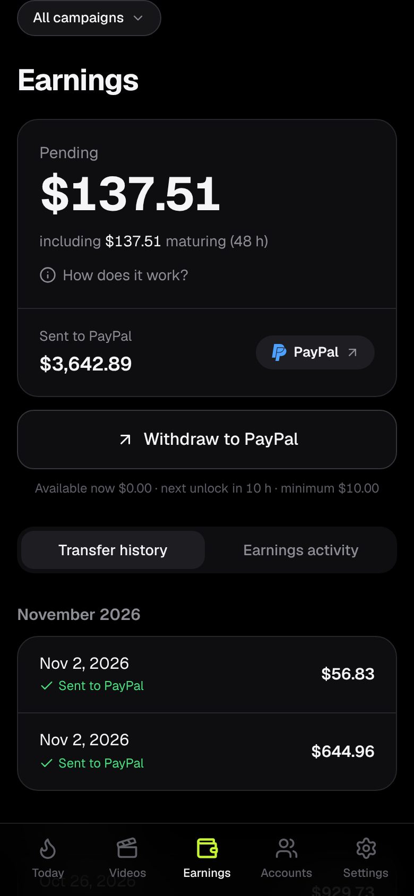
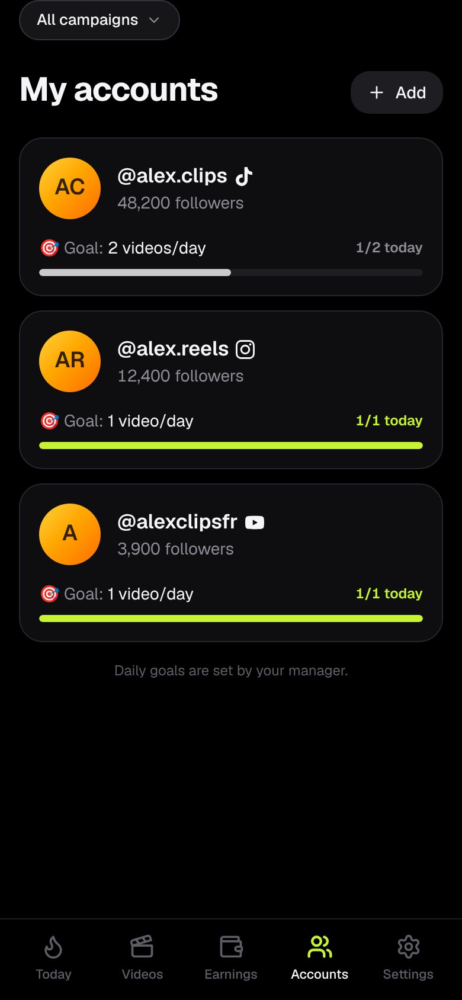
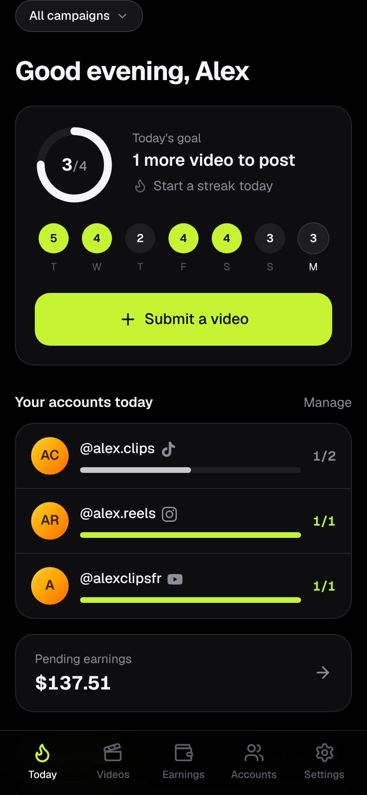
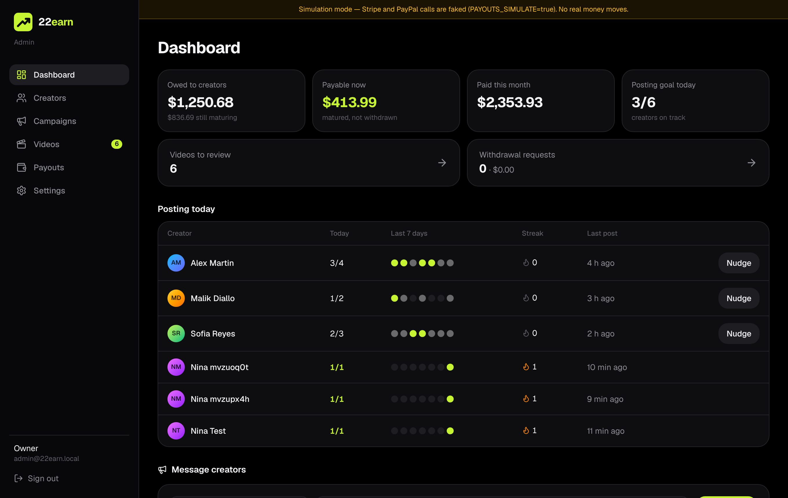

# 22earn

**Post often. Track every cent. Get paid with Stripe or PayPal.**

22earn is a web app (installable on phones as a PWA) for running a team of creators:

- **Creators (influencer rights)** see what they earn, live — pending balance, the part still
  *maturing*, what was already sent, and their transfer history. They're **pushed to post often**
  with daily goals per account, streaks, push reminders and messages from you.
- **You (admin rights)** manage everything in the same app: invite creators, run campaigns with
  your rates, review videos, enter views, give bonuses, set posting goals, and pay out with
  **Stripe** or **PayPal** in one click.

| Earnings (creator) | My accounts (creator) | Today (creator) |
|---|---|---|
|  |  |  |



---

## 1. Run it on your computer (2 minutes)

Requirements: [Node.js 20.9+](https://nodejs.org) (22 LTS recommended). Nothing else: no database to install.

```bash
npm install
cp .env.example .env        # works as-is for local testing
npm run db:seed             # optional: demo data (creators, videos, payouts)
npm run dev                 # → http://localhost:3000
```

- **With demo data:** sign in as `admin@22earn.local` / `admin12345` (admin) or
  `alex@22earn.local` / `creator12345` (creator).
- **Without demo data:** open http://localhost:3000. It sends you to `/setup` to create the
  owner (admin) account. That page locks itself forever once an account exists.

Locally the app uses an **embedded PostgreSQL** (PGlite, stored in `./.data`). To start over,
stop the server and delete `.data/`. `.env.example` ships with `PAYOUTS_SIMULATE=true`, which
fakes Stripe and PayPal so you can test the whole payout flow without keys.

> Open the creator view on your phone (same Wi-Fi: `http://<your-PC-IP>:3000`) to see the mobile app.

---

## 2. How the money works

Every cent is an **append-only ledger row** (integer cents, never floats). Balances are derived:

| What the creator sees | Meaning |
|---|---|
| **Pending** | everything earned and not yet paid out |
| **…maturing (48 h)** | new earnings in the hold period (you set the hours) |
| **Available** | matured money that can be withdrawn |
| **Sent to Stripe / PayPal** | total of successful transfers |

**Where earnings come from**
- **Campaign rates:** a fee per approved video and/or a rate per 1,000 views, with an optional cap
  per video. Rates are **frozen when you approve** a video, so later rate changes never rewrite a deal.
- **Views:** enter a video's current view count (Admin → Videos). Only the difference is paid.
  Corrections downward and rejections create negative rows, so history is never lost.
- **Bonuses / adjustments:** Admin → Creators → a creator → "Give money".

**Payouts**

```
requested ──approve──▶ processing ──▶ paid
    │                       │
    └─reject/cancel─▶ canceled        └──▶ failed   → the money goes back to the creator's balance
```

- A creator taps **Withdraw** (from the minimum you set). You get a push, then **Approve & send**.
  Or use **Pay all available** to pay everyone at once (like a weekly payday).
- **Double payments are prevented at every level:** a database row lock per creator, conditional
  status updates (two admins clicking "Approve" at once send only once), and Stripe idempotency keys
  plus PayPal request ids, so a retry can never pay twice.
- If a provider *refuses* a payout, it's marked failed and the money returns to the balance. If
  the answer is *unknown* (timeout), it stays "processing" and **Retry** is safe.

---

## 3. Stripe setup (Stripe Connect)

Creators connect a **Stripe Express** account. You send them a **Transfer** from your platform
balance, and Stripe pays it out to their bank on their payout schedule.

1. Create a Stripe account → enable **Connect** (Dashboard → Connect → Get started). Choose
   *"Platform or marketplace"*, with Express accounts.
2. Developers → API keys → copy the **secret key** into `STRIPE_SECRET_KEY` (`sk_test_…` while testing).
3. Developers → Webhooks → **Add endpoint** `https://YOUR_DOMAIN/api/webhooks/stripe`.
   - Turn on **"Listen to events on Connected accounts"**.
   - Events: `account.updated`, `transfer.reversed`.
   - Copy the signing secret into `STRIPE_WEBHOOK_SECRET`.
4. **Fund your platform balance.** Transfers come out of your *available* Stripe balance. If it's
   empty, payouts fail with "insufficient funds" (the money stays safe in the creator's balance).
   Depending on your country, use [top-ups](https://docs.stripe.com/connect/top-ups) or your own
   Stripe revenue.
5. **Countries:** Stripe allows transfers within the same region, and between the US, Canada, UK,
   EEA and Switzerland ([docs](https://docs.stripe.com/connect/account-capabilities)). To pay
   creators in other countries, look at the `recipient` service agreement
   (`STRIPE_SERVICE_AGREEMENT=recipient`) and Stripe Global Payouts, and confirm with Stripe for
   your platform's country ([docs](https://docs.stripe.com/connect/service-agreement-types)).

The creator flow: Settings → **Connect with Stripe** → Stripe onboarding (identity and bank) →
back in the app as "Connected". The **Stripe ↗** pill on Earnings opens their Express dashboard.

## 4. PayPal setup (PayPal Payouts)

Money goes from **your PayPal Business balance** to the creator's PayPal email.

1. You need a **PayPal Business** account. Payouts must be enabled on it for live use (ask PayPal
   to activate *Payouts*). Sandbox works right away.
2. [developer.paypal.com](https://developer.paypal.com/dashboard/applications) → Apps & Credentials →
   create an app → copy **Client ID / Secret** into `PAYPAL_CLIENT_ID` / `PAYPAL_CLIENT_SECRET`.
   Set `PAYPAL_MODE=sandbox` or `live`.
3. In the app's settings → Webhooks → add `https://YOUR_DOMAIN/api/webhooks/paypal` with the
   **Payment payouts-item** and **Payment payoutsbatch** events → copy the **Webhook ID** into
   `PAYPAL_WEBHOOK_ID`.
4. Keep enough balance in PayPal. If an email has no PayPal account, the payout stays
   **unclaimed** for 30 days, then returns (the app then puts the money back in the creator's balance).

Webhooks are signature-verified, and the app then **re-reads the real status from the PayPal API**.
The admin also has a **Refresh status** button.

## 5. Posting reminders (push notifications)

1. `npm run vapid:generate` → put the keys in `VAPID_PUBLIC_KEY` / `VAPID_PRIVATE_KEY`
   (and an email in `VAPID_SUBJECT`).
2. Set `CRON_SECRET` to a long random string, and call `GET /api/cron/reminders` with the header
   `Authorization: Bearer <CRON_SECRET>` every 15–60 minutes. The Docker setup does this for you.
   Elsewhere, use any free cron service (e.g. cron-job.org).
3. At the hours you choose (Admin → Settings, creator's local time, e.g. `12,18,21`), creators who
   haven't hit today's goal get: *"1 video left today to keep your 🔥 5-day streak."*

Creators turn reminders on from **Today** or **Settings**. **iPhone:** iOS 16.4+ and the app must
be added to the Home Screen (Share → *Add to Home Screen*). The app shows these steps itself.
Admins can also turn on push to be alerted about withdrawal requests.

---

## 6. Put it online

### Option A — your own server (recommended: cheapest, you own everything)

Any VPS with Docker (e.g. Hetzner, DigitalOcean, OVH, ~€5/month). The included stack has
**PostgreSQL + the app + automatic HTTPS (Caddy) + the reminder cron + daily database backups**.

```bash
# on the server
git clone <this repo> 22earn && cd 22earn
cp .env.example .env
#   DOMAIN=earn.example.com            (DNS A record → the server's IP)
#   APP_URL=https://earn.example.com
#   POSTGRES_PASSWORD=<openssl rand -hex 24>
#   CRON_SECRET=<openssl rand -hex 32>
#   PAYOUTS_SIMULATE=false
#   + Stripe / PayPal / VAPID keys
docker compose up -d --build
```

Then open `https://earn.example.com`. You land on `/setup` to create your owner account.
Database migrations run automatically on every start. Backups are written daily to `./backups`
and kept for 14 days. Copy them off the server regularly.

Update later with `git pull && docker compose up -d --build`.

### Option B — Vercel + a managed Postgres (Neon / Supabase)

1. Create a Postgres database (Neon free tier works) and copy its connection string.
2. Import the repo in Vercel and set the environment variables from `.env.example`
   (`DATABASE_URL` = the Postgres URL, `APP_URL` = your Vercel URL, `PAYOUTS_SIMULATE=false`).
   With a *pooled* URL, also set `DATABASE_PREPARE=false`.
3. Run the migrations once from your computer:
   `DATABASE_URL=<direct url> npm run db:migrate`, and again after each update that adds a migration.
4. Reminders: on the Hobby plan Vercel only allows daily cron jobs, so use an external cron
   (cron-job.org) to call `/api/cron/reminders` with the `Authorization` header.

> The embedded database is for your computer only. Online, always use a real PostgreSQL.

---

## 7. Security

- Passwords hashed with bcrypt (cost 12). Sessions are random 256-bit tokens; only their SHA-256
  is stored. Cookies are httpOnly, `SameSite=Lax`, and `Secure` on HTTPS.
- **Every** page and server action re-checks the session and role on the server. A creator can
  only read and write their own rows (covered by tests).
- Invite and password-reset links are single-use, hashed, and expire after 7 days. A reset signs
  the user out everywhere.
- Login rate limiting, a first-run `/setup` that locks itself, signature-verified webhooks, and a
  bearer-protected cron. Security headers are set (no framing, nosniff, strict referrer).
- Payout destinations are **frozen when a withdrawal is requested**, so the admin approves exactly
  where the money goes.

## 8. Useful commands

| Command | What it does |
|---|---|
| `npm run dev` | migrate + start the dev server |
| `npm run build && npm start` | production build / server |
| `npm test` | unit + ledger/payout integration tests (embedded Postgres) |
| `TEST_DATABASE_URL=postgres://… npm test` | same tests on a real PostgreSQL |
| `npm run typecheck` | TypeScript |
| `npm run db:generate` | create a migration after editing `src/db/schema.ts` |
| `npm run db:migrate` | apply migrations |
| `npm run db:seed` | demo data (empty database only) |
| `npm run admin:create -- --email you@x.com --password '…'` | create an admin / reset a lost admin password |
| `npm run vapid:generate` | keys for push notifications |

## 9. Stack

Next.js 16 (App Router, Server Actions) · React 19 · TypeScript · Tailwind CSS 4 ·
Drizzle ORM · PostgreSQL (PGlite locally) · Stripe Connect · PayPal Payouts REST API · Web Push ·
Vitest · Docker + Caddy.

## 10. Not included yet (good next steps)

- Automatic view counts from the TikTok / Instagram / YouTube APIs (today the admin enters views).
- Sending invite links by email (today you copy the link and send it by WhatsApp/DM/email).
- App Store / Play Store builds: the PWA already installs on phones. A store version can wrap this
  same app later.

See [`app-spec.md`](app-spec.md) for the full spec and the fidelity checklist.
